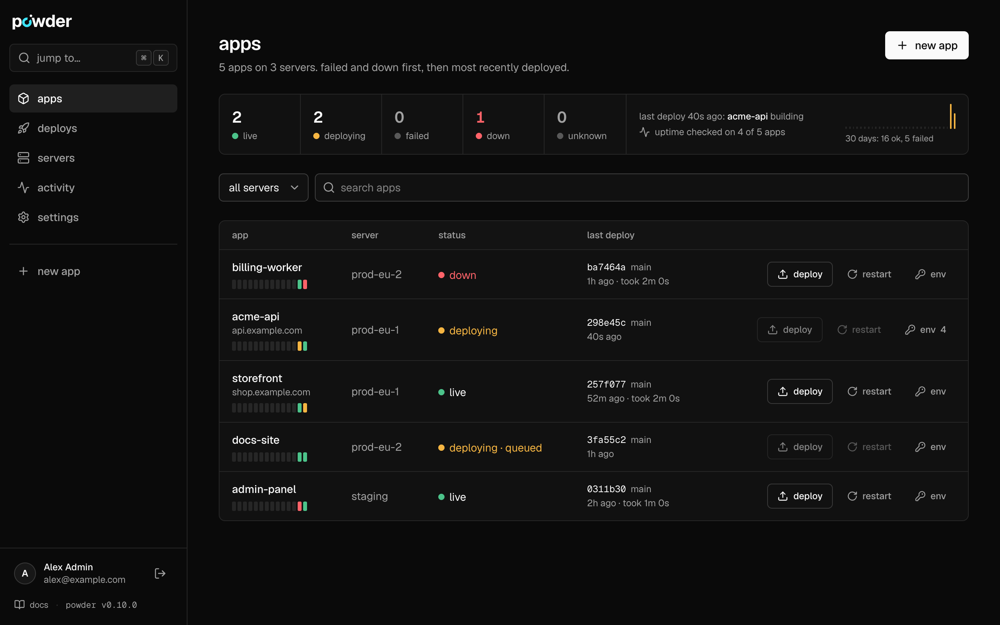
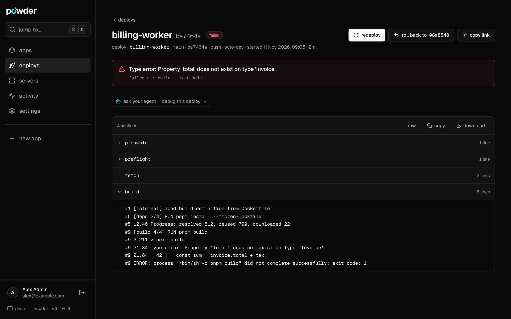

<h1>
  <picture>
    <source media="(prefers-color-scheme: dark)" srcset="brand/powder-wordmark-dark.svg">
    
  </picture>
</h1>

**Push to deploy on servers you own.**

Self-hosted, Vercel-style deploys to **your own servers**.

Push to GitHub → powder builds the app **on the target server** (or a dedicated
builder) → health-checks the new container → swaps it in. No CI service or
registry required, no YAML pipelines. One Next.js app + a worker, a Postgres database,
and SSH to the machines you already have.

```
git push  ──▶  GitHub webhook  ──▶  powder
                                      │  fresh clone on the server
                                      │  docker compose build (serialized, mem-gated)
                                      │  optional test gate (.powder/test.sh)
                                      │  health check ──▶ old container stays if red
                                      ▼
                                  container swapped, old image kept for rollback
```



*Every app on every server: live, deploying or failing, and its last deploy.*

## What it does

- **Build-on-server deploys** from GitHub webhooks: the server's compose file
  carries a `build:` section pointing at the app's checkout; every deploy syncs
  it to the pushed commit and rebuilds from source.
  Fallback-safe: a failed build leaves the old container running.
- **Health gate before the swap**: the new image starts next to the live
  container and must answer its health check first; when it fails, the old
  container keeps serving and the deploy fails. Without a health URL any
  answer below 500 passes, and a candidate that never answers HTTP (a worker)
  skips the gate.

  

  *A failed build never goes live: the page shows where it broke, with redeploy and roll back.*

- **Env vars, Vercel-style**: env lives encrypted (AES-256-GCM) in powder's
  DB, rendered to the server at deploy time. A drift guard refuses to clobber
  disk-only edits, loudly.
- **Postgres backups**: per-app dumps, encrypted, multipart-uploaded to any
  S3-compatible store (large dumps upload in parts), keep-N retention,
  staleness alerting.
- **Test gate (opt-in CI)**: a `.powder/test.sh` in your repo blocks the swap
  on failure. No external CI service.
- **Dedicated builder**: optionally build on a separate server and stream the
  image to the target, keeping production machines out of build load. Set
  "build host" on the server's page.
- **Preview deploys** (opt-in per app, on the app's Settings tab): a push to
  another branch gets its own container at `pv-<app>-<branch>.<base domain>`,
  with its own preview env.
- **Deploy snapshots**: open any past deploy's image on its own temporary URL
  (on demand, torn down after an hour).
- **Custom domains**: add a hostname, verify it by DNS, and powder adds it to
  the app's Traefik router, which requests its Let's Encrypt certificate.
  Previews, snapshots and custom domains need a Traefik server (the default);
  previews and snapshots also need a base domain on it.
- **Uptime checks and crons**: opt-in uptime probes (the app's Settings tab,
  with its health URL) every 5 minutes with an
  alert after 2 failures, and HTTP cron jobs run by powder's own scheduler.
- **Alerts**: deploy, uptime, backup and cron events to any number of
  webhook targets (Discord and Slack incoming webhooks work) and email over
  your own SMTP server, per event and per app, set at `/settings/notifications`.
- **Dashboard**: servers, containers, deploys, logs (live SSE), crons,
  domains, uptime, backups in one place.

### Switching features on

Off by default. Switch them on in the dashboard, or over the API from a signed-in
browser session (API tokens cannot change these; the server setting needs an admin):

| Feature | Dashboard | API |
|---|---|---|
| Health URL (deploy gate, uptime, Traefik health check) | app → Settings → health and uptime | `PATCH /api/projects/<id>` `{"healthUrl": "/api/health"}` |
| Uptime checks | app → Settings → uptime checks | `PATCH /api/projects/<id>` `{"uptimeEnabled": true}` |
| Preview deploys | app → Settings → preview deploys | `PATCH /api/projects/<id>` `{"previewsEnabled": true}` |
| Dedicated builder | server page → settings → build host | `PATCH /api/servers/<id>` `{"buildHost": "builder.example.com"}` |

## Philosophy

- The **app's GitHub repo is the source of truth**; on-server checkouts are
  disposable.
- **One deploy shape for every app**: no per-app snowflakes.
- **Absence of signal is failure**: missing exit codes, unreachable health
  endpoints and silent branches are treated as errors, not success.
- Small enough to read. No Kubernetes.

## Quickstart

On a Linux server with root, 2 GB of memory or more, a dashboard hostname whose
DNS already points at the server, and a GitHub OAuth app (callback
`https://<host>/api/auth/callback/github`):

```bash
sudo git clone --branch v0.10.0 https://github.com/powder-sh/powder /opt/apps/powder/src
cd /opt/apps/powder/src
sudo bin/install.sh
```

Then open `https://<host>/setup` with the token it prints. Step by step, with
the server, DNS and first app: [Quickstart](apps/web/content/docs/quickstart.md).
Operator reference: [docs/SELF-HOSTING.md](docs/SELF-HOSTING.md).

**What your repo needs:** a Dockerfile. See
[What your repo needs](apps/web/content/docs/app-requirements.md).

**Development:** see [CONTRIBUTING.md](CONTRIBUTING.md).

## Security

Powder runs on your servers and you are responsible for them. Read the
[security model](apps/web/content/docs/security-model.md) and
[SECURITY.md](SECURITY.md) before you expose it.

- The one outbound call on by default is a daily GitHub release check (one
  request, a `powder/<version>` User-Agent, nothing else; off with
  `POWDER_UPDATE_CHECK=off`).
- Everything else runs only when you use or configure it:
  - the GitHub API (login, webhook and deploy key setup, CI status), when you
    connect GitHub, including the Deployments API: each deploy of a connected
    repository creates a GitHub deployment whose `log_url` is the deploy's
    page on your dashboard (`BETTER_AUTH_URL`);
  - Docker's apt repository at download.docker.com, only when you accept the
    Docker install in `bin/install.sh` or run `bin/server-bootstrap.sh
    --apply` on a server without Docker (Debian and Ubuntu; the repository
    key is trusted only when its fingerprint is
    `9DC858229FC7DD38854AE2D88D81803C0EBFCD88`). Docker's convenience script
    from get.docker.com runs only with `--docker-script`
    (`POWDER_GET_DOCKER_SHA256` pins it);
  - image pulls from Docker Hub: `node`, `pgvector/pgvector`, `traefik`,
    `postgres` and `redis`, pinned by digest for powder's own services
    (generated Dockerfiles for your apps pin exact tags);
  - the npm registry during image builds (powder's own image and your apps'
    dependency installs);
  - Let's Encrypt (ACME), from the Traefik that `bin/server-bootstrap.sh`
    starts, to issue certificates for your domains;
  - PostHog (`NEXT_PUBLIC_POSTHOG_KEY` with `NEXT_PUBLIC_POSTHOG_HOST`; events and exception capture,
    session recording off);
  - ops endpoint reporting to an endpoint of your own (`POWDER_HQ_*`, see
    "Optional integrations" in docs/SELF-HOSTING.md; not needed for alerts);
  - Anthropic (`ANTHROPIC_API_KEY`: the "diagnose with AI" button on a failed
    CI run);
  - a notification webhook (`POWDER_NOTIFY_WEBHOOK_URL`: `deploy_failed`,
    `app_down`, `app_up` and `cron_failed`, works with Discord and Slack
    incoming webhooks) and the targets at `/settings/notifications`;
  - your own SMTP server (`POWDER_SMTP_URL`), your own S3 (`BACKUP_S3_*`), and
    your own apps (uptime probes, HTTP crons).

## Status

Beta. It runs the author's production servers daily, but expect opinionated
defaults and sharp edges. Issues and PRs welcome.

Known limitations:

- One operator per install. Every user who can sign in to the dashboard is an admin (their id is in `POWDER_ADMIN_USER_IDS`); there are no roles.
- GitHub only: no GitLab or other git hosts.
- Backups cover Postgres databases only.
- A running deploy cannot be cancelled; it ends on success, failure or timeout.
- Traefik is the default proxy. Servers on nginx (`proxy=nginx` or
  `nginx-container`) deploy, redirect and roll back apps, but have no custom
  domains, previews, snapshots or traffic stats, and a rollback recreates the
  container instead of switching traffic atomically.
- The GitHub OAuth app asks for the `repo`, `admin:repo_hook`, `read:user` and
  `user:email` scopes, to add deploy keys and webhooks to your repositories.
- The public site (landing page and docs) is dark only.

## Repository layout

| Path | What it is |
|---|---|
| `apps/web` | The Next.js dashboard, API and public site; the worker runs the same image. Docs pages in `apps/web/content/docs`. |
| `packages/db` | Drizzle schema (`src/schema`) and the SQL migrations (`drizzle/`). |
| `packages/config` | Shared TypeScript configs. |
| `bin/` | Install, upgrade and server scripts: `install.sh`, `self-deploy.sh`, `server-bootstrap.sh`, `db-init.sh`, `lib-migrations.sh`, `lib-db-layout.sh` (the DB layout rule `install.sh` and `self-deploy.sh` share). |
| `bin/fleet-check.sh` | Checks every app's uptime URL and each server's registry login setup; `bin/self-deploy.sh` runs it before and after an upgrade. |
| `infra/` | The per-server helpers `powder-migrate`, `powder-image-prune.sh` and the optional `powder-resource-guard.sh`. |
| `docker/` | powder's Dockerfile, its entrypoint and `powder.env.example`. |
| `docker-compose.yml` | powder, the worker and their database. |
| `docker-compose.dev.yml` | The development database (see [CONTRIBUTING.md](CONTRIBUTING.md)). |
| `docker-compose.shared-db.yml` | Override for a server whose powder database sits on the shared `internal` network (the shared-network layout, a supported option with a warning); added by the scripts when they detect it. |
| `docker-compose.unharden.yml` | Override for `POWDER_HARDEN=false`: drops the container hardening. |
| `docker-compose.web-readonly.yml` | Override for `POWDER_WEB_READONLY=true`: a read-only root filesystem for powder. |
| `docker-compose.pin-report.yml` | Used by `bin/self-deploy.sh --pin-report` only: builds its images under their own tags. |
| `docs/` | Operator reference (`SELF-HOSTING.md`) and the compose and build rules (`SECURITY-COMPOSE.md`). |
| `templates/` | A reference Dockerfile for a Next.js app. |
| `brand/` | Logos, screenshots and the script that generates the icons. |

## License

Copyright (C) 2026 Mari Luukkainen

Powder is free software, licensed under the GNU Affero General Public License
v3.0 or later (AGPL-3.0-or-later). You may use, modify and redistribute it, but
if you run a modified version as a network service you must offer its complete
source to the users of that service, and derivative works must stay under the
same license. See [LICENSE](LICENSE) for the full text. There is no warranty.
